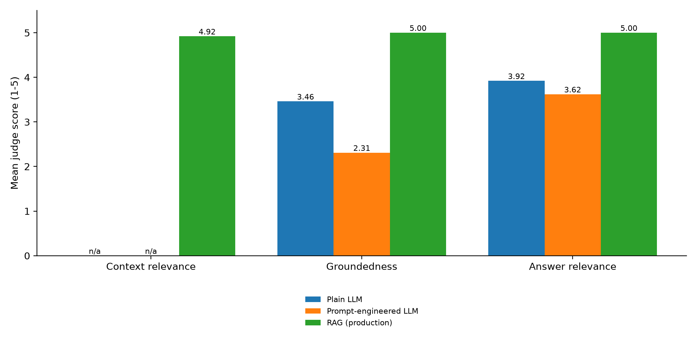

# Experiment: public_approach

Mean scores (1-5) over answerable queries.

| config | context_relevance | groundedness | answer_relevance | page_cited_answers | correct_refusals | guideline_hit_rate | page_hit_rate | unwarranted_refusals | mean_latency_s |
|---|---|---|---|---|---|---|---|---|---|
| Plain LLM | n/a | 3.46 | 3.92 | 0/13 | 0/3 | n/a | n/a | 0/13 | 5.8 |
| Prompt-engineered LLM | n/a | 2.31 | 3.62 | 0/13 | 0/3 | n/a | n/a | 0/13 | 7.1 |
| RAG (production) | 4.92 | 5 | 5 | 13/13 | 3/3 | 13/13 | 12/13 | 0/13 | 2.6 |

Corpus: 10 VA/DoD Clinical Practice Guidelines (`public`). These numbers are not directly comparable to the Merck results (summary_approach.md): different corpus, different query set, and narrower guideline-specific questions. Retrieval hit rates count RAG answers whose top-k context contains the expected guideline (guideline hit) or a chunk from that guideline's expected recommendation/discussion pages (page hit).

## Per-query scores (context_relevance / groundedness / answer_relevance)

| query | Plain LLM | Prompt-engineered LLM | RAG (production) | RAG retrieval hit (guideline/page) |
|---|---|---|---|---|
| P01 Diabetes: glycemic target | –/1/2 | –/1/2 | 5/5/5 | yes/yes |
| P02 Diabetes: pharmacotherapy | –/5/5 | –/5/5 | 5/5/5 | yes/yes |
| P03 Hypertension: BP goal | –/5/5 | –/4/5 | 5/5/5 | yes/yes |
| P04 Hypertension: resistant HTN | –/3/3 | –/1/3 | 5/5/5 | yes/yes |
| P05 Lipids: primary prevention | –/3/3 | –/1/3 | 5/5/5 | yes/yes |
| P06 Lipids: statin intolerance | –/4/5 | –/3/5 | 5/5/5 | yes/yes |
| P07 Asthma: step-up therapy | –/4/5 | –/1/3 | 4/5/5 | yes/no |
| P08 COPD: initial maintenance therapy | –/3/4 | –/1/3 | 5/5/5 | yes/yes |
| P09 CKD: SGLT2 inhibitors | –/4/5 | –/2/4 | 5/5/5 | yes/yes |
| P10 Depression: continuation phase | –/4/5 | –/3/4 | 5/5/5 | yes/yes |
| P11 Low back pain: pharmacotherapy | –/2/2 | –/1/2 | 5/5/5 | yes/yes |
| P12 Headache: acute migraine | –/4/4 | –/4/4 | 5/5/5 | yes/yes |
| P13 Insomnia: first-line treatment | –/3/3 | –/3/4 | 5/5/5 | yes/yes |
| P14 Out of scope (near miss: COPD antibiotics) | –/1/5 | –/1/5 | 1/5/1 | – |
| P15 Out of scope (near miss: gout as side effect) | –/1/5 | –/1/5 | 1/5/1 | – |
| P16 Out of scope | –/1/5 | –/1/5 | 1/5/1 | – |

## Analysis (hand-written; re-running the harness overwrites this file, so re-add this section)

Run 2026-11-12: generator gpt-4o-mini (temperature 0, production multi-document system prompt),
judge gpt-4o, k=5 MMR over 200-token chunks, 13 answerable + 3 out-of-scope questions, one run
(n=16, so differences of a few tenths are within noise). API cost was about $0.44.

- **Retrieval:** the expected guideline appeared in the top-5 for 13/13 answerable questions;
  a chunk from the expected recommendation or discussion pages appeared for 12/13. The miss
  (P07, asthma) retrieved a neighbouring page about the same inhaler strategy, not the
  recommendation for patients uncontrolled on ICS alone. A page hit only means a chunk from
  that page range was retrieved, not that the chunk states the recommendation (see P08).
- **Refusals:** 3/3 out-of-scope questions got the exact "not found" refusal from RAG, including
  the two near misses (pneumonia antibiotics with COPD exacerbation context retrieved; gout with
  lipid-drug side-effect context retrieved). The non-RAG baselines answered all three (0/3).
  RAG never refused an answerable question (0/13).
- **Suspiciously perfect scores.** RAG groundedness and answer relevance are 5.00 on every
  answerable question. Manual review against the expected recommendations shows the judge does
  not catch clinically wrong or incomplete answers when they are traceable to *some* retrieved
  text:
  - P08 *"What initial maintenance inhaler therapy is recommended for COPD with a moderate to
    severe symptom burden?"* — scored 5/5/5, but the answer is **wrong**: it recommends triple
    therapy (ICS/LABA/LAMA), lifted from the outpatient-exacerbation sidebar. The guideline
    recommends LABA/LAMA over monotherapy (Rec 8); that sentence was not in the retrieved chunks.
  - P07 *"What inhaler regimen is recommended for a patient whose asthma is uncontrolled on an
    inhaled corticosteroid alone?"* — scored 4/5/5, but misses the key recommendation (ICS plus
    rapid-onset LABA such as formoterol as both controller **and reliever**, Rec 7). It also adds a
    "do not use maintenance inhalers for relief" warning taken from the **COPD** guideline. That
    warning contradicts the asthma controller/reliever strategy: content leaked across guidelines.
  - P09 (CKD + SGLT2i) answered mostly from the diabetes guideline and omits the CKD guideline's
    albuminuria and heart-failure indications (Rec 15). P11 (chronic low back pain drugs) lists
    duloxetine and three "against" classes but omits NSAIDs and the recommendations against
    opioids, benzodiazepines and systemic corticosteroids. Both scored 5/5/5 but are incomplete.
  - Manual verdict: 9/13 RAG answers correct and complete enough to act on, 2 incomplete
    (P09, P11), 2 wrong or misleading (P07, P08).
- **Baselines:** without retrieval the model answered from general knowledge, e.g. HbA1c <7% (ADA)
  instead of the VA/DoD 7.0–8.5% range (P01: groundedness 1). The judge also marked those answers
  down on *answer relevance* for disagreeing with the context, although the rubric says to ignore
  grounding. That rubric leakage is why baseline answer relevance (3.6–3.9) is lower than on Merck.
- **Not comparable to Merck** (summary_approach.md): different corpus, different questions
  (narrow, recommendation-level here versus broad textbook topics there), and different
  out-of-scope probes.

**Recommended follow-ups:** add a reference-answer correctness metric (the judge compares the
answer with the expected recommendation, not only with the retrieved context). Also test
same-guideline filtering or reranking so that a COPD chunk cannot supply asthma advice.
